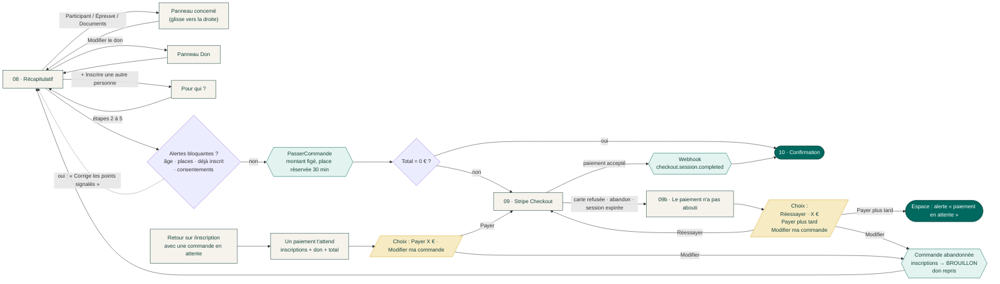
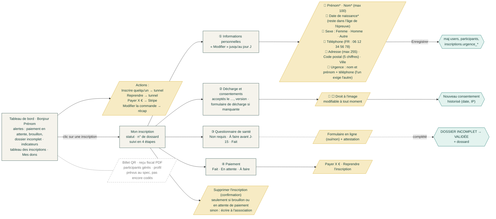
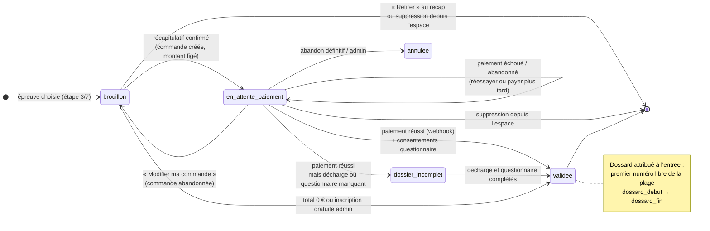

# Run For Lorène · Parcours utilisateur et données saisies

Diagrammes établis à partir du code en place (`routes/web.php`, `routes/auth.php`, `livewire/auth/identification`, `livewire/inscription/tunnel`, `livewire/espace/inscription`, `PaiementController`, services `Inscriptions/*` et `Paiement/*`), recoupés avec `docs/spec.md`. Les écarts entre le code et le spec sont listés en fin de document.

**Légende**

| Forme | Signification |
|---|---|
| Rectangle crème | Écran ou panneau |
| Parallélogramme moutarde `📝` | Données saisies par l'utilisateur (`*` = obligatoire) |
| Hexagone vert | Traitement serveur (ce qui est enregistré) |
| Losange | Condition / branchement |
| Pointillés gris | Prévu au spec, pas encore codé |

---

## 1. Vue d'ensemble du tunnel

Chaque bande correspond à une étape. De gauche à droite : l'écran, ce que l'utilisateur saisit, ce que le serveur enregistre. « Retour » ne perd jamais une saisie : tout est enregistré côté serveur à chaque « Continuer ».

```mermaid
flowchart TB
    classDef ecran fill:#F5F3EC,stroke:#16403B,color:#16403B
    classDef saisie fill:#F7EBC4,stroke:#D6AD2B,color:#16403B
    classDef serveur fill:#E3F3EF,stroke:#00695F,color:#16403B
    classDef prevu fill:#FFFFFF,stroke:#999,stroke-dasharray:5 4,color:#777
    classDef fin fill:#00695F,stroke:#0B4F48,color:#FFFFFF

    subgraph S01["01 · Page de l'événement (publique)"]
        direction LR
        E01["Page RFL3<br/>héro · chiffres clés · épreuves<br/>(départ, public, tarif, places)<br/>la cause · pied de page légal"]:::ecran
        D01[/"Aucune saisie<br/>Boutons : S'inscrire · Choisir une épreuve<br/>Se connecter · Mon espace<br/>Télécharger le règlement (PDF)"/]:::saisie
        V01{{"Inscriptions ouvertes ?<br/>sinon : écran « Inscriptions fermées »"}}:::serveur
        E01 --- D01 --- V01
    end

    subgraph S1["Étape 1/7 · Compte (écrans 03-04) · détail au § 2"]
        direction LR
        E1["Connecte-toi<br/>puis Content de te revoir / Bienvenue !<br/>puis Vérifie tes emails"]:::ecran
        D1[/"📝 Email*<br/>compte existant : 📝 Mot de passe*<br/>nouveau compte : 📝 Prénom* · Nom* · Mot de passe* (8 min.)<br/>📝 Code à 6 chiffres* si email non vérifié"/]:::saisie
        V1{{"users : prenom, nom, email,<br/>mot_de_passe haché, email_verified_at"}}:::serveur
        E1 --- D1 --- V1
    end

    subgraph S2["Étape 2/7 · Participant (écran 05) · « Pour qui ? »"]
        direction LR
        E2["Pour qui ?<br/>Moi-même · participant déjà géré<br/>· Une autre personne (enfant, proche)"]:::ecran
        D2[/"📝 Choix* (1 seul, grisé si déjà inscrit)<br/>📝 Prénom* (max 100, prérempli)<br/>📝 Nom* (max 100, prérempli)<br/>📝 Date de naissance* (calendrier, passée)"/]:::saisie
        V2{{"Moi : maj users + participants<br/>Autre : users sans email<br/>+ participants.id_responsable = moi<br/>Refus si déjà inscrit à l'événement"}}:::serveur
        E2 --- D2 --- V2
    end

    subgraph S3["Étape 3/7 · Épreuve (écran 02)"]
        direction LR
        E3["Choisis ton épreuve<br/>uniquement les courses ouvertes<br/>à l'âge le jour de l'événement"]:::ecran
        D3[/"📝 Épreuve* (1 carte)<br/>« Complet » / « Tarif indisponible » = grisée<br/>badge « Plus que N places »"/]:::saisie
        V3{{"Vérifie âge, places, tarif du jour<br/>inscription BROUILLON<br/>(tarif, participant, événement)"}}:::serveur
        E3 --- D3 --- V3
    end

    subgraph S4["Étape 4/7 · Documents et consentements (écran 06)"]
        direction LR
        E4["Tes documents<br/>« aucun certificat médical ni licence »"]:::ecran
        D4[/"1. 📝 Décharge* : affirmations à cocher + approbation<br/>2. 📝 Questionnaire de santé* (mineurs seulement) : oui/non + attestation<br/>3. 📝 ☑ Règlement* · ☑ RGPD* · ☐ Droit à l'image"/]:::saisie
        V4{{"documents + consentements<br/>version du texte, date, IP, oui/non"}}:::serveur
        P4[/"Un volet par panneau, enregistré à chaque « Continuer »<br/>Pas de « plus tard » : tout est rempli avant de payer"/]:::saisie
        E4 --- D4 --- V4
        D4 -.- P4
    end

    subgraph S5["Étape 5/7 · Don (écran 07) · facultatif, bouton « Passer »"]
        direction LR
        E5["Un coup de pouce en plus ?"]:::ecran
        D5[/"📝 Don : 5 · 10 · 20 · 50 € ou autre montant<br/>(0 à 10 000 €, 2 décimales)<br/>si don > 0 : 📝 ☐ Reçu fiscal · 📝 ☐ Anonyme"/]:::saisie
        V5{{"Gardé en session<br/>jusqu'à la commande"}}:::serveur
        P5[/"Taille de t-shirt (stock par taille)<br/>prévu au spec, pas encore codé"/]:::prevu
        E5 --- D5 --- V5
        D5 -.- P5
    end

    subgraph S6["Étape 6/7 · Récapitulatif (écran 08) · détail au § 3"]
        direction LR
        E6["On vérifie ensemble ?<br/>1 ligne par participant + don + total"]:::ecran
        D6[/"Modifier : Participant · Épreuve · Documents · Don<br/>Retirer un participant (confirmation)<br/>+ Inscrire une autre personne<br/>bouton Payer X € / Valider mon inscription"/]:::saisie
        V6{{"Commande EN_COURS, total figé<br/>inscriptions EN_ATTENTE_PAIEMENT<br/>prix historisé · place réservée 30 min"}}:::serveur
        E6 --- D6 --- V6
    end

    subgraph S7["Étape 7/7 · Paiement (écrans 09, 09b)"]
        direction LR
        E7["Stripe Checkout<br/>(simulation hors production)"]:::ecran
        D7[/"📝 Carte / Apple Pay / Google Pay<br/>saisis chez Stripe, jamais sur le site"/]:::saisie
        V7{{"Webhook signé et idempotent<br/>paiement RÉUSSI : référence, montant, frais"}}:::serveur
        E7 --- D7 --- V7
    end

    subgraph S10["10 · Confirmation · « C'est dans la boîte ! »"]
        direction LR
        E10["Récap, dossards,<br/>documents manquants + date limite"]:::ecran
        D10[/"Boutons : Inscrire une autre personne<br/>· Aller à mon espace"/]:::saisie
        V10{{"Complet : VALIDÉE + dossard<br/>(1er numéro libre de la plage)<br/>Sinon : DOSSIER INCOMPLET"}}:::serveur
        E10 --- D10 --- V10
    end

    S01 -->|"S'inscrire"| S1
    S1 -->|"connecté, email vérifié"| S2
    S2 -->|"Continuer"| S3
    S3 -->|"Continuer"| S4
    S4 -->|"Continuer (3 cases cochées)"| S5
    S5 -->|"Ajouter X € / Passer"| S6
    S6 -->|"total > 0 €"| S7
    S6 -->|"total = 0 €"| S10
    S7 -->|"paiement réussi"| S10
    S10 --> ESP(["11 · Espace participant · détail au § 4"]):::fin
```

---

## 2. Étape 1/7 · Compte (identification « email d'abord »)

L'email décide seul entre connexion et création de compte, comme chez Google.

```mermaid
flowchart LR
    classDef ecran fill:#F5F3EC,stroke:#16403B,color:#16403B
    classDef saisie fill:#F7EBC4,stroke:#D6AD2B,color:#16403B
    classDef serveur fill:#E3F3EF,stroke:#00695F,color:#16403B

    A["Connecte-toi"]:::ecran --> A1[/"📝 Adresse email*<br/>format RFC, max 254<br/>30 essais / min par IP"/]:::saisie
    A1 --> Q{"Compte existant ?"}

    Q -->|oui| B["Content de te revoir"]:::ecran
    B --> B1[/"📝 Mot de passe*<br/>(Afficher / Masquer)<br/>5 essais / min"/]:::saisie
    B1 -->|"correct + email vérifié"| OK{{"Connexion<br/>session régénérée"}}:::serveur
    B1 -->|"correct, email non vérifié"| C
    B1 -->|"Mot de passe oublié ?<br/>Recevoir un code"| C
    B1 -.->|"incorrect"| B

    Q -->|non| N["Bienvenue !<br/>email en pastille, « Modifier »"]:::ecran
    N --> N1[/"📝 Prénom* (max 100)<br/>📝 Nom* (max 100)<br/>📝 Mot de passe* (8 min.)"/]:::saisie
    N1 -->|"Créer mon compte"| NS{{"Crée users<br/>envoie un code par email"}}:::serveur
    NS --> C

    C["Vérifie tes emails"]:::ecran --> C1[/"📝 Code à 6 chiffres*<br/>valable 15 min · 5 essais<br/>« renvoyer » après 60 s"/]:::saisie
    C1 -->|"code bon"| CV{{"Email marqué vérifié"}}:::serveur --> OK
    C1 -.->|"invalide ou expiré"| C

    OK --> T["Retour au tunnel<br/>(étape 2/7)"]:::ecran
```

---

## 3. Récapitulatif, paiement et reprises

---

## 4. Espace participant (écran 11)

---

## 5. Cycle de vie d'une inscription

---

## 6. Récapitulatif des données saisies

| Étape | Écran | Champ | Type | Obligatoire | Règles |
|---|---|---|---|---|---|
| 1/7 Compte | Connecte-toi | Adresse email | email | ✅ | RFC, max 254, 30 essais/min par IP |
| | Content de te revoir | Mot de passe | masqué (Afficher) | ✅ | 5 essais/min ; « Recevoir un code » en secours |
| | Bienvenue ! | Prénom | texte | ✅ | max 100 |
| | | Nom | texte | ✅ | max 100 |
| | | Mot de passe | masqué (Afficher) | ✅ | 8 caractères min. |
| | Vérifie tes emails | Code | 6 chiffres | ✅ | valable 15 min, 5 essais, renvoi après 60 s |
| 2/7 Participant | Pour qui ? | Choix | Moi / participant géré / autre personne | ✅ | déjà inscrit = grisé |
| | | Prénom | texte | ✅ | max 100, prérempli |
| | | Nom | texte | ✅ | max 100, prérempli |
| | | Date de naissance | calendrier | ✅ | passée, après 1900 ; filtre les épreuves (âge au jour J) |
| 3/7 Épreuve | Choisis ton épreuve | Épreuve | carte à sélectionner | ✅ | âge, places, tarif en vigueur |
| 4/7 Documents | Tes documents | Règlement | case | ✅ | version + date + IP |
| | | Décharge + santé : maintenant ou plus tard | choix | ✅ | « plus tard » : avertissement « pas de départ sans ces documents » |
| | | Décharge : affirmations + approbation (si maintenant) | cases | ✅ | toutes les affirmations cochées ; nom du signataire et date affichés ; réponses chiffrées, version + date + IP |
| | | Questionnaire de santé + attestation (si maintenant) | oui/non + case | ✅ | toutes les questions et l'attestation ; réponses chiffrées |
| | | RGPD | case | ✅ | idem |
| | | Droit à l'image | case | — | oui/non enregistré |
| 5/7 Don | Coup de pouce | Montant | 5/10/20/50 € ou libre | — | 0 à 10 000 €, 2 décimales ; « Passer » |
| | | Reçu fiscal | case | — | si don > 0 |
| | | Anonyme | case | — | si don > 0 |
| 6/7 Récap | On vérifie ensemble ? | — | modifier / retirer / ajouter | — | aucune alerte bloquante pour payer |
| 7/7 Paiement | Stripe Checkout | Carte / Apple Pay / Google Pay | Stripe | ✅ si total > 0 | place réservée 30 min |
| Espace | Informations personnelles | Prénom, Nom | texte | ✅ | max 100 |
| | | Date de naissance | calendrier | ✅ | reste dans la tranche d'âge de l'épreuve |
| | | Sexe | liste | — | femme / homme / autre |
| | | Téléphone | tel | — | FR `0[1-9]` + 8 chiffres, +33 accepté |
| | | Adresse | texte | — | max 255 |
| | | Code postal | texte | — | 5 chiffres |
| | | Ville | texte | — | max 100 |
| | | Urgence : nom et prénom | texte | ↔ | max 150, exigé si téléphone d'urgence |
| | | Urgence : téléphone | tel | ↔ | format FR, exigé si nom d'urgence |
| | Décharge et consentements | Droit à l'image | case | — | modifiable jusqu'au jour J, historisé |

---

## 7. Écarts entre le code et le spec

À trancher : soit le spec est mis à jour, soit le code est complété.

- **Ordre du tunnel** : le spec prévoit Épreuve (02) → Compte (03-04) → Participant (05). Le code fait Compte → Participant → Épreuve, pour filtrer les épreuves selon l'âge avant de les afficher (choix documenté dans `tunnel.blade.php`).
- **Écran 05 allégé** : sexe, téléphone, adresse et contact d'urgence ne sont pas demandés dans le tunnel. Ils se remplissent après coup dans l'espace (tous facultatifs).
- **Lien magique → code** : le spec parle d'un lien magique valable 15 minutes. Le code envoie un code à 6 chiffres valable 15 minutes, qui sert aussi à vérifier l'email.
- **Questions de santé** : provisoires (version 1), en attendant celles du Google Form. **Décharge** : affirmations du Google Form « Décharge Responsabilité Adulte ».
- **Option t-shirt** (écran 07) : absente du tunnel ; seule l'étape Don existe.
- **Don seul sans inscription** : le bouton « Faire un don » de la page événement pointe vers une ancre, sans parcours dédié.
- **Espace participant** : le billet QR, le reçu fiscal PDF, la gestion des participants gérés et le profil ne sont pas encore codés.
- **Emails** : confirmation de paiement, validation, relances (J-15, paiement en attente 24 h) prévus au spec, à vérifier au lot 4-5.
